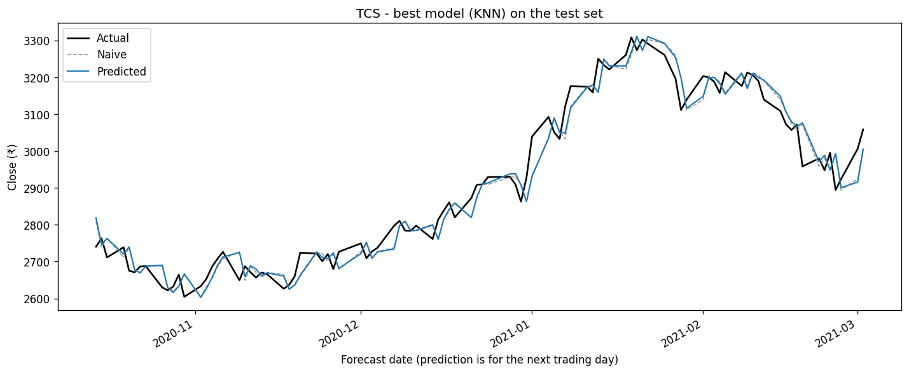
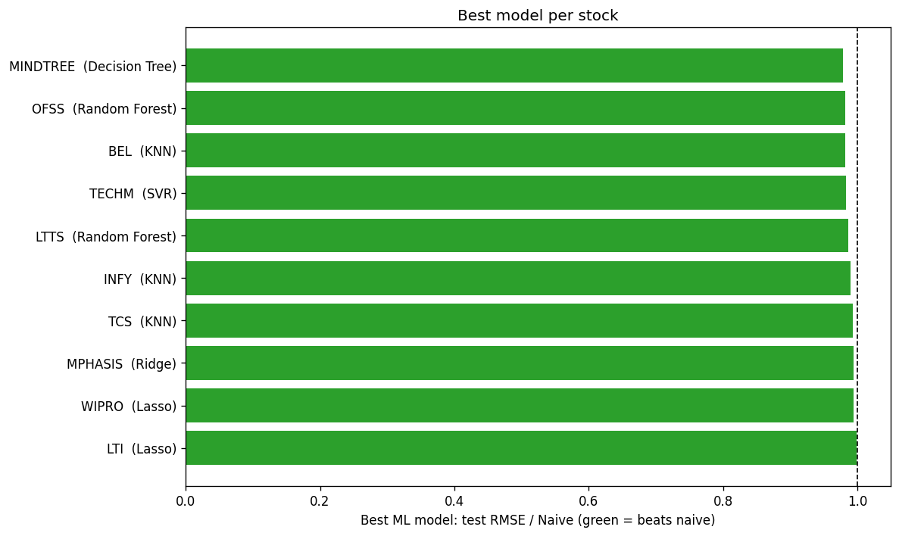
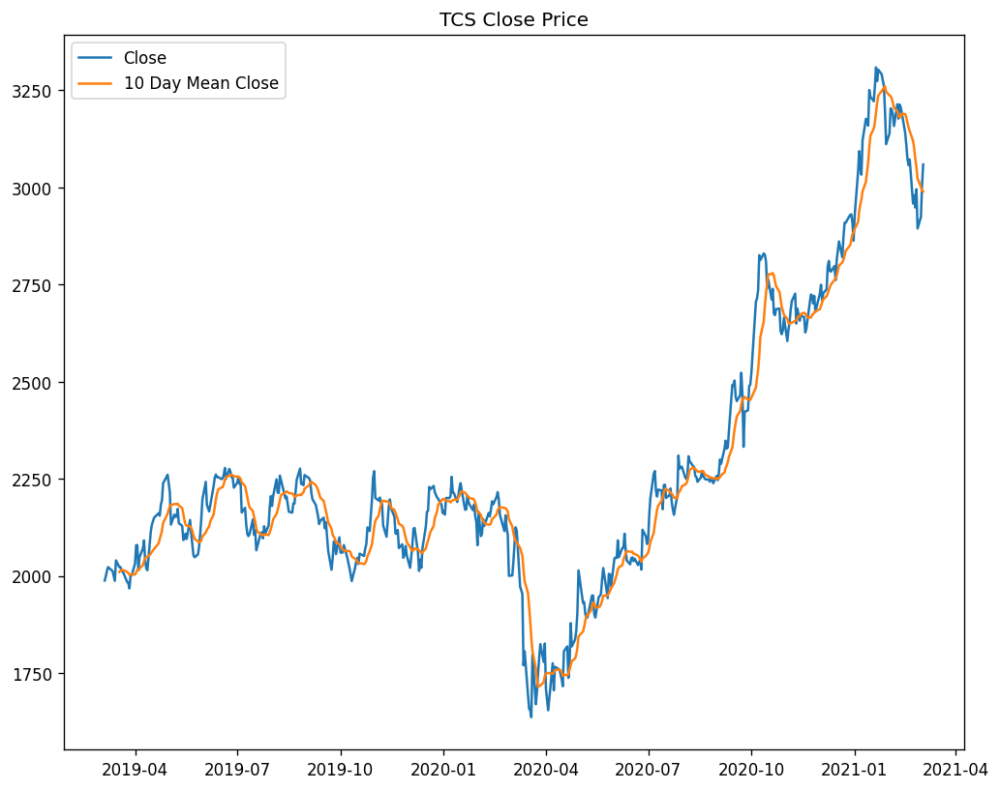
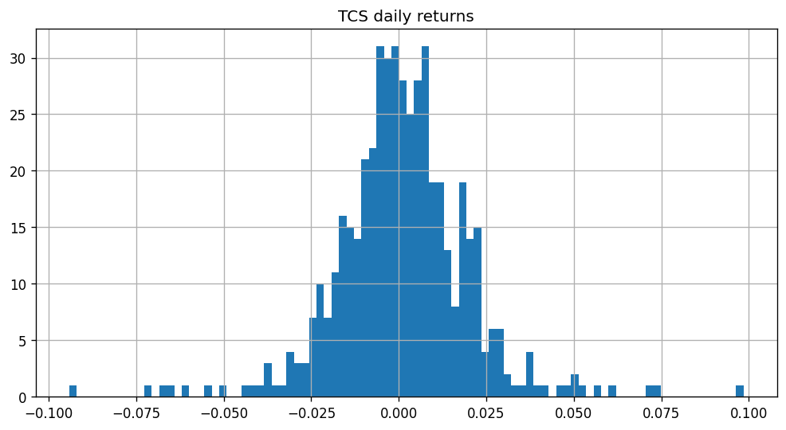
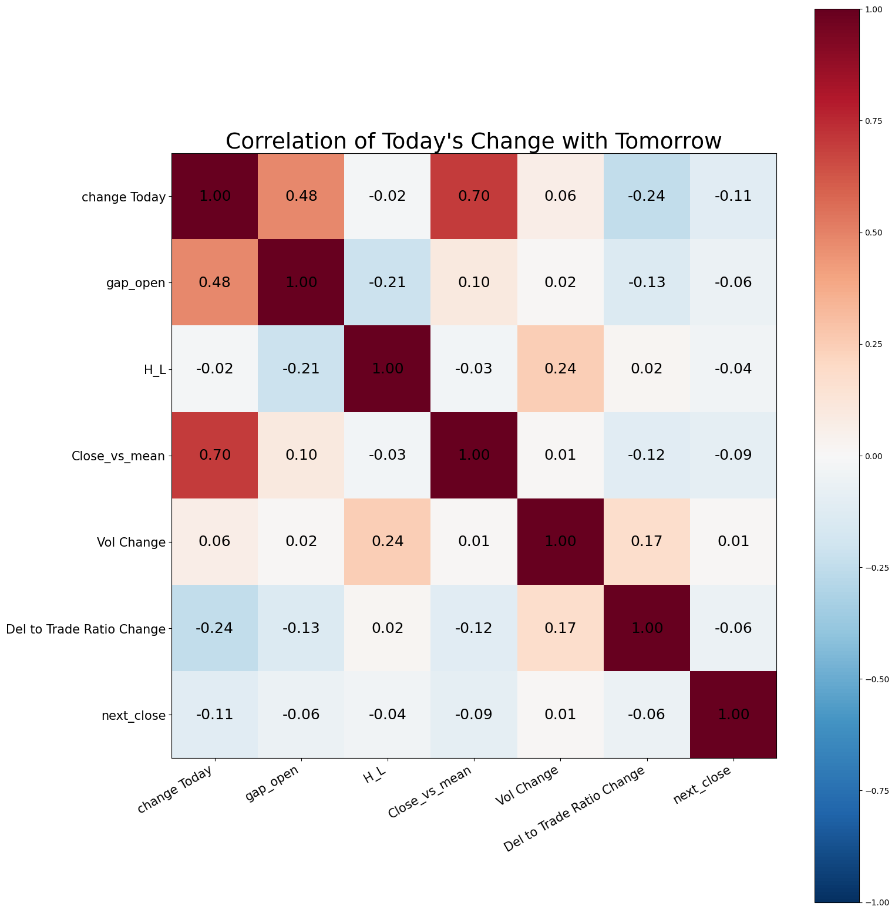
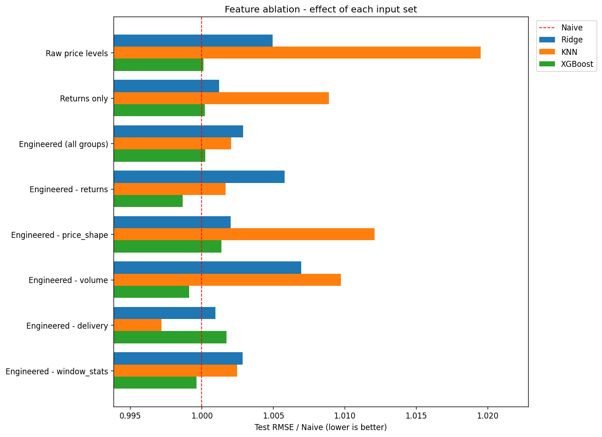
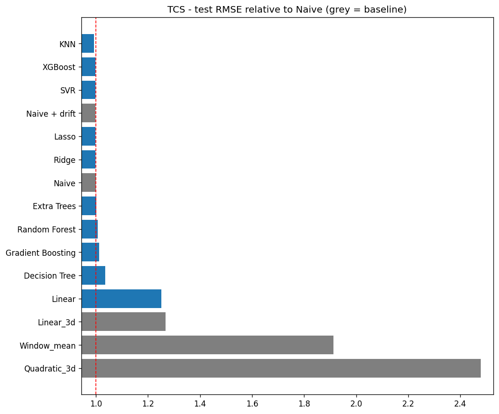
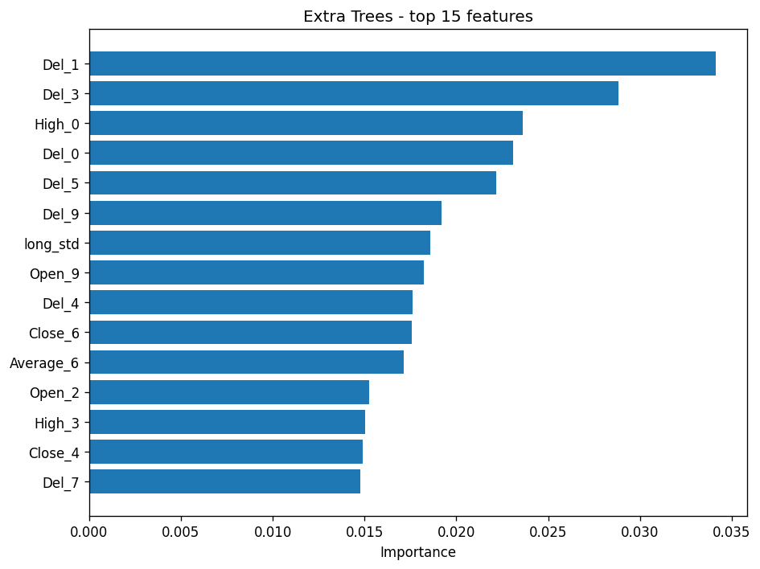
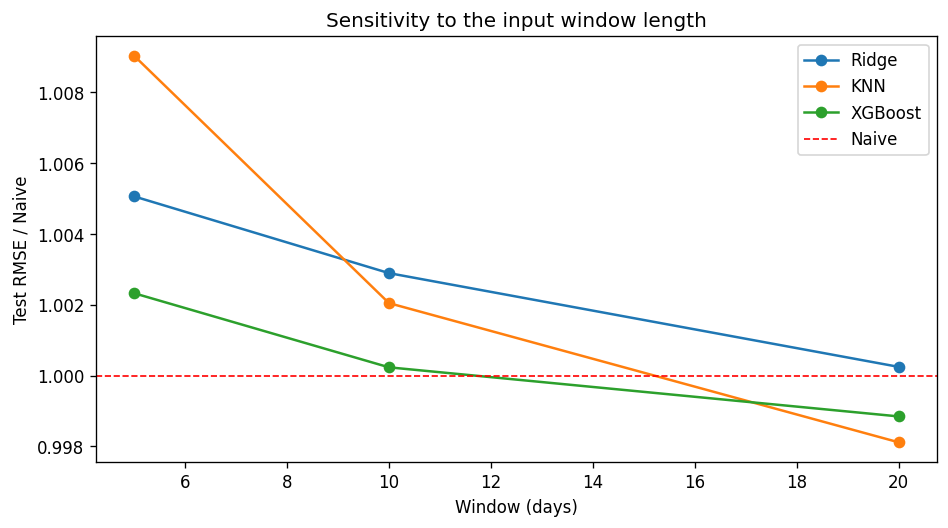

# Next-Day Stock Price Prediction with EDA-Driven Feature Engineering

Forecasting the next trading day's closing price of ten NSE-listed stocks from the previous *N* days of market data. The project covers the full workflow — **exploratory data analysis → feature engineering based on the EDA findings → tuning and comparison of 10 machine-learning models against rule-based baselines** — with leakage-safe time-series validation and an ablation study that measures how much the engineered inputs contribute.

**Result:** the best tuned model edges out the naive forecast on all 10 stocks, but only by **0.1 – 2.2 % RMSE** (best: Decision Tree on MINDTREE, RMSE 2.2 % below naive). Direction accuracy ranges from 46 % to 61 %. Next-day returns in this data are close to unpredictable from price and volume history alone — a result the EDA anticipates and the ablation study confirms.

<p align="center">
  
  
</p>

## Problem

Given daily open, high, low, close, VWAP, volume, number of trades and delivery percentage, predict the **next day's close**. Daily price changes are small and noisy, so every model is judged against two strong benchmarks: the **naive** forecast (tomorrow = today) and **naive + drift** (today × average daily return).

## Data

Daily NSE data for TCS, INFY, WIPRO, TECHM, LTI, LTTS, MINDTREE, MPHASIS, OFSS and BEL, March 2019 – March 2021 (~500 trading days per stock, including the COVID-19 crash). See [`data/README.md`](data/README.md) for the column dictionary and cleaning steps.

## 1. Exploratory data analysis

Notebook: [`stock_prediction.ipynb`](stock_prediction.ipynb), sections 1–2.

<p align="center">
  
  
  
</p>

The EDA determined how the model inputs are built:

| EDA finding | Decision |
|---|---|
| Block-deal (`BL`) rows duplicate trading days | Keep only regular `EQ` rows |
| Price levels are non-stationary and highly correlated with each other | Predict the next-day **return**, then convert back to a price |
| Test-period prices lie outside the training range | Express price inputs **relative to the current close** |
| Volume and trades are skewed and trending | **Log ratio** to a rolling mean |
| Today's signals correlate only weakly with tomorrow's return | Regularised models; benchmark against naive and drift |
| Training and test periods cover different market regimes | **Chronological split** and `TimeSeriesSplit` cross-validation |

Key numbers for TCS (the stock used in the figures):

- A typical daily move is **1.34 %** (mean absolute return); daily returns have a standard deviation of 1.89 % and a mean of +0.10 %. The largest single-day move was 9.85 % on 20-Mar-2020.
- The naive forecast is already hard to beat: its mean absolute error is **₹29.92** over the full period.
- Raw price columns correlate at 0.99+ with one another — a shared trend, not predictive information.
- The strongest correlation between any of today's stationary signals and tomorrow's return is **−0.11** (today's return, i.e. slight mean reversion); every other signal is below |0.09|.

## 2. Feature engineering

Notebook section 3 · code: [`src/features.py`](src/features.py)

For each day, the previous `window` trading days are summarised in five feature groups (`9 × window + 3` features), using only information available at that day's close:

| Group | Description |
|---|---|
| `returns` | Daily returns |
| `price_shape` | Open / high / low / average and past closes relative to today's close |
| `volume` | Log volume and log number of trades relative to their rolling mean |
| `delivery` | Delivery-to-traded ratio |
| `window_stats` | Window return, volatility and gaps to short and full moving averages |

Sanity checks confirm that all features are scale-free and that features for any date are unchanged when later data is removed (no look-ahead bias).

**Feature ablation.** The same models are trained on *raw price levels*, *returns only*, the *full engineered set*, and the engineered set with each group removed in turn, averaged over all stocks.

<p align="center">
  
</p>

Mean test RMSE / Naive across the ten stocks (window = 10; lower is better, 1.00 = naive):

| Feature set | Ridge | KNN | XGBoost |
|---|---|---|---|
| Raw price levels | 1.005 | 1.019 | 1.000 |
| Returns only | 1.001 | 1.009 | 1.000 |
| **Engineered (all groups)** | 1.003 | 1.002 | 1.000 |
| Engineered − returns | 1.006 | 1.002 | 0.999 |
| Engineered − price_shape | 1.002 | 1.012 | 1.001 |
| Engineered − volume | 1.007 | 1.010 | 0.999 |
| Engineered − delivery | 1.001 | 0.997 | 1.002 |
| Engineered − window_stats | 1.003 | 1.002 | 1.000 |

What it shows:

- The engineered inputs matter most for **KNN**, the distance-based model: raw price levels put it 1.9 % behind naive, the scale-free engineered set brings it level (1.002). Dropping `price_shape` or `volume` costs KNN about 1 % again.
- **Ridge** and **XGBoost** are nearly indifferent to the input set — every row is within ±0.7 % of naive. Heavy regularisation (Ridge α = 10⁴–10⁵) and shallow trees mean both models largely learn the constant drift regardless of what they are given.
- No feature set pushes any model meaningfully below 1.0. The transforms make the inputs *well-behaved*; they do not make tomorrow's return *predictable*.

## 3. Modelling

Notebook sections 4–10 · code: [`src/models.py`](src/models.py), [`src/pipeline.py`](src/pipeline.py)

| Group | Models |
|---|---|
| Baselines | Naive, naive + drift, linear / quadratic 3-day extrapolation, moving average |
| Linear | Linear Regression, Ridge, Lasso |
| Distance / kernel | KNN, SVR (RBF) |
| Trees | Decision Tree, Random Forest, Extra Trees, Gradient Boosting, XGBoost |

- Hyperparameters tuned with `GridSearchCV` on 5-fold `TimeSeriesSplit` using the training period only.
- Feature scaling inside a `Pipeline`, fitted on each training fold only.
- Evaluation on the held-out test period in price terms: RMSE, MAE, MAPE, **RMSE relative to naive** and direction accuracy.
- Next-day forecast from each model refitted on all available data.

<p align="center">
  
  
</p>

## Results

Best tuned model per stock on the held-out test period (last 20 % of days, ~97 trading days, Oct 2020 – Mar 2021):

| Stock | Best model | Test RMSE (₹) | RMSE / Naive | Direction accuracy |
|---|---|---|---|---|
| MINDTREE | Decision Tree | 35.83 | 0.978 | 52.6 % |
| OFSS | Random Forest | 42.57 | 0.982 | 57.7 % |
| BEL | KNN | 2.96 | 0.983 | 57.7 % |
| TECHM | SVR | 18.38 | 0.983 | 52.6 % |
| LTTS | Random Forest | 65.09 | 0.986 | 60.8 % |
| INFY | KNN | 19.75 | 0.990 | 60.8 % |
| TCS | KNN | 42.68 | 0.993 | 55.7 % |
| MPHASIS | Ridge | 30.95 | 0.994 | 46.4 % |
| WIPRO | Lasso | 6.92 | 0.995 | 54.6 % |
| LTI | Lasso | 100.37 | 0.999 | 46.4 % |

For TCS in detail, 5 of the 10 tuned models (KNN, XGBoost, SVR, Lasso, Ridge) finish below naive and the other 5 above it; the whole field sits between 0.993 and 1.036 except unregularised Linear Regression (1.25), which overfits the 93 inputs. All three extrapolating baselines (3-day linear and quadratic fits, window mean) are far worse than naive (1.27 – 2.48).

**Sensitivity to the input window** (5, 10 and 20 days):

<p align="center">
  
</p>

| Window | Ridge | KNN | XGBoost |
|---|---|---|---|
| 5 | 1.005 | 1.009 | 1.002 |
| 10 | 1.003 | 1.002 | 1.000 |
| 20 | 1.000 | 0.998 | 0.999 |

A longer window helps slightly and consistently for all three models, but the whole range spans under 1 % of naive RMSE.

**Conclusions**

- **Nothing beats naive by a convincing margin.** The best model is under 1.0 on every stock, but the margins (0.1 – 2.2 %) are of the size expected from picking the luckiest of ten models on a single ~97-day test window, and the winning model differs from stock to stock — there is no consistent champion.
- **The tuned models collapse towards "predict the drift".** Grid search selects Ridge α = 10⁴–10⁵, SVR C = 10⁻⁴, KNN k = 50 and tree depths of 2–3: each model shrinks its predictions almost all the way to a constant return, which is why their RMSE lands within a rounding error of naive + drift.
- **Direction accuracy stays near coin-flip** (46 – 61 %), which agrees with the EDA correlation of −0.11 between today's and tomorrow's return.
- **The EDA-driven features earn their place for the right reasons.** Modelling returns instead of prices lets tree models work at all on a test period that trades above the training range, and the scale-free transforms are what make KNN competitive. What they cannot do is manufacture signal that the data does not contain at a one-day horizon.

## How to run

**Requirements:** Python 3.9+ ([python.org](https://www.python.org/downloads/); on Windows tick *Add Python to PATH*).

| Windows | macOS / Linux |
|---|---|
| Double-click **`run.bat`** | `bash run.sh` |

The first run creates a local virtual environment and installs the packages. The pipeline then runs every model on every stock plus the experiments.

Manual setup:

```bash
pip install -r requirements.txt
python main.py                                  # settings from config.yaml
python main.py --symbols TCS INFY --window 10   # override settings
python main.py --skip-experiments               # models only, faster
pytest                                          # tests
```

The notebook is run from the project root: `jupyter notebook stock_prediction.ipynb`.

Settings are in [`config.yaml`](config.yaml): symbols (`all` or a list), the stock used for the README figures, window length, test fraction, models and experiment options.

## Outputs

| Location | Contents | Committed |
|---|---|---|
| `reports/figures/` | Figures shown in this README | Yes |
| `reports/results/` | Ranked results table per stock, per-model test plots, experiment tables | No (re-created by `main.py`) |

| Figure | Created by |
|---|---|
| `eda_price.png`, `eda_return_distribution.png`, `eda_signal_correlation.png`, `feature_importance.png` | `stock_prediction.ipynb` |
| `model_comparison.png`, `best_model_prediction.png` | `main.py` (stock set by `readme_symbol`) |
| `best_model_per_stock.png`, `feature_ablation.png`, `window_sensitivity.png` | `main.py` experiments |

## Project structure

```
├── data/
│   ├── raw/Stock_Price_Data.csv
│   └── README.md                 data dictionary and cleaning notes
├── src/
│   ├── config.py                 settings (config.yaml + command line)
│   ├── data_loader.py            loading and cleaning
│   ├── features.py               feature groups, target, chronological split
│   ├── baselines.py              rule-based forecasts
│   ├── models.py                 models, grids, time-series tuning
│   ├── evaluate.py               metrics
│   ├── pipeline.py               end-to-end run per stock
│   ├── experiments.py            feature ablation, window sensitivity
│   └── visualize.py              plots
├── reports/
│   ├── figures/                  README figures
│   └── results/                  generated tables and plots
├── tests/test_features.py        leakage, feature and metric tests
├── stock_prediction.ipynb        EDA, feature engineering and model development
├── config.yaml
├── main.py
└── run.bat / run.sh
```

## Limitations and future work

- A single chronological test window of about five months; walk-forward evaluation over several windows would give more robust estimates and would show whether the small gains over naive are real or selection noise.
- Only stock-level inputs are used; sector indices, market-wide returns or news sentiment could add signal.
- Point forecasts only; prediction intervals or a direction classifier would be natural extensions.
- Sequence models (LSTM / temporal CNN) could be added as a further comparison.
- A longer horizon (weekly or monthly returns) may be more forecastable than the next day and is a cheap change to the target.

## Tech stack

Python · pandas · NumPy · scikit-learn · XGBoost · Matplotlib · Jupyter · pytest

## Disclaimer

For educational purposes only; not financial advice.
